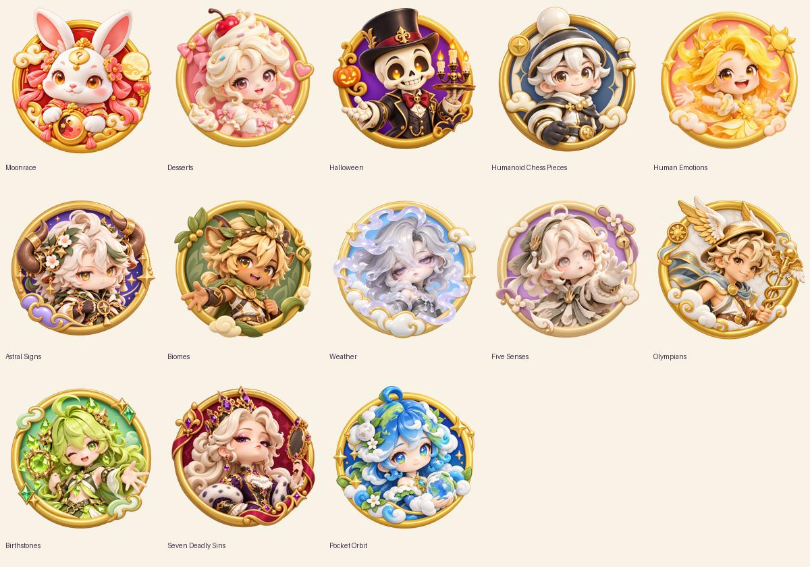

# New collection artwork receipt

Thirteen transparent 1254×1254 PNG emblems, generated with the built-in imagegen tool. Moonrace was redesigned at the owner's follow-up request and its replacement upload was explicitly approved in chat. All thirteen uploads were validated and uploaded through `scripts/upload_assets.py`; public IDs/provenance are in `assets/uploads.json` and generated `AssetIds.luau`. No live place was published.



The new emblems are used by Collection/Shop and repeated as the box panel motif through `ShopTheme`. Box collection names are native scaled/wrapped text on the nameplate, so small raster emblems do not contain tiny titles. Existing corners are not consumers in the current screen system and no unrelated art was redesigned.

## Exact prompt set

Each call used the existing `moonrace/moonrace_emblem.png` as image 1 (style only), and the figure reference below as image 2. Transparent background was requested and all delivered alpha channels span 0–255. The following template was expanded with each collection name and palette exactly:

```text
Use case: stylized-concept. Generate ONE square transparent collection emblem for the existing Roblox blind-box game, collection {name}. Image 1 is a STYLE reference only: keep its polished toy-like 3D circular badge, rounded sculpted gold rim, warm studio shading and generous transparent margin. Image 2 is the actual character reference: faithfully preserve this character's face, hair, clothes, silhouette and colors, centered as a large bust inside the badge. Do not include the character from image 1. Collection palette for badge/background: {palette}. Add only two or three simple related decorative motifs around the rim. Strong uncluttered silhouette recognizable at 42px. No text, no letters, no captions, no watermark; collection title is rendered legibly by the game's separate text label. All decoration fully inside a 90% safe square; genuine transparent outside the badge. This single emblem is also used as the repeated motif on box panels.
```

| Collection | Actual figure reference under assets/reference_models | Palette | Saved PNG | Image asset ID |
| --- | --- | --- | --- | --- |
| Desserts | desserts/cupcake_common.png | rose pink and caramel cream | [desserts/desserts_emblem.png](desserts/desserts_emblem.png) | 139928128134713 |
| Halloween | halloween/skeleton_butler_common.png | purple and pumpkin orange | [halloween/halloween_emblem.png](halloween/halloween_emblem.png) | 77148150075575 |
| Humanoid Chess Pieces | humanoid-chess-pieces/pawn_common.png | ivory, slate blue and brass | [humanoid-chess-pieces/humanoid_chess_pieces_emblem.png](humanoid-chess-pieces/humanoid_chess_pieces_emblem.png) | 109575715651280 |
| Human Emotions | human-emotions/joy_common.png | rose, apricot and warm cream | [human-emotions/human_emotions_emblem.png](human-emotions/human_emotions_emblem.png) | 96882384703856 |
| Astral Signs | astral-signs/taurus_common.png | lavender, indigo and gold stars | [astral-signs/astral_signs_emblem.png](astral-signs/astral_signs_emblem.png) | 98682151441520 |
| Biomes | biomes/savanna_common.png | sage, moss and sandy gold | [biomes/biomes_emblem.png](biomes/biomes_emblem.png) | 71218672248391 |
| Weather | weather/fog_common.png | sky blue, cloud white and pale gold | [weather/weather_emblem.png](weather/weather_emblem.png) | 136787788372184 |
| Five Senses | five-senses/touch_common.png | lilac, mauve and cream | [five-senses/five_senses_emblem.png](five-senses/five_senses_emblem.png) | 139742772367042 |
| Olympians | greek-gods/hermes_common.png | ivory marble, warm gold and pale blue | [olympians/olympians_emblem.png](olympians/olympians_emblem.png) | 114778265922638 |
| Birthstones | birthstones/peridot_common.png | jade, mint and warm gold | [birthstones/birthstones_emblem.png](birthstones/birthstones_emblem.png) | 138752080376496 |
| Seven Deadly Sins | seven-deadly-sins/pride_common.png | garnet, dark rose and gold | [seven-deadly-sins/seven_deadly_sins_emblem.png](seven-deadly-sins/seven_deadly_sins_emblem.png) | 80220035740135 |
| Pocket Orbit | pocket-orbit/earth_common.png | indigo, blue, green and gold | [pocket-orbit/pocket_orbit_emblem.png](pocket-orbit/pocket_orbit_emblem.png) | 130785821492119 |

Visual review: consistent circular badge style, recognizable reference likeness and uncluttered silhouettes at thumbnail size. Native moderation/access, ViewportFrame/world appearance, final 42px rendering and physical-device legibility still require Studio/device acceptance.

## Moonrace redesign (owner follow-up)

Saved as [moonrace_emblem_v2.png](moonrace/moonrace_emblem_v2.png), replacing the mapping at `Collection.Moonrace.Emblem` with asset **100215376124772**. The original local PNG and prior Roblox asset **92403306538274** remain available. Moonrace now reuses the new emblem as its box-panel motif, just like the other twelve new collections. The new badge and box motif were observed in the local Studio Shop at landscape-phone viewport 666×374.

The generation prompt used Desserts and Humanoid Chess Pieces emblems as style references and `assets/reference_models/moonrace/rabbit_legendary.png` for actual character likeness. It specified a polished sculpted gold circular rim, large Rabbit bust, white face, amber eyes, pink-lined ears, coral ribbons, forehead moon charm, flowers and moon medallion against lacquer red, with moon/cloud/lantern accents; no text and a transparent outside. A second built-in imagegen pass preserved the design while asking for a complete uncropped silhouette and a clean transparent margin. No 3D figure was changed.

Automatic upload review initially rejected the remote replacement because explicit approval was missing. The owner then explicitly approved the Moonrace artwork upload; the normal `moonrace_emblem --replace --timeout 600` command completed. This does not authorize publishing a place or bypass the separate external-model review gate.
